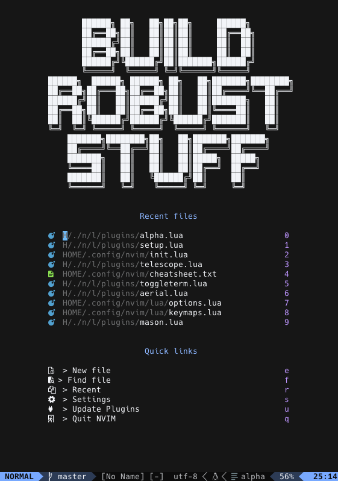

# Dotfiles

macOS 用の個人 dotfiles。シェル・エディタ・ターミナル・AI エージェント（Claude Code / Codex）の設定と、macOS の初期設定をまとめて管理する。



## 仕組み

- パッケージは [Homebrew](https://brew.sh/)（`homebrew/Brewfile`）と `mise bootstrap` の `[bootstrap.packages]` で入れる
- 設定ファイルは `mise bootstrap` の `[dotfiles]` で `$HOME` 配下へ symlink（一部はコピー）する
- macOS の設定（Dock / Finder / キーボード / `defaults`）・ログインシェル・追加セットアップタスクも `mise bootstrap` が反映する
- 設定の実体: [`HOME/.config/mise/conf.d/bootstrap.toml`](HOME/.config/mise/conf.d/bootstrap.toml)

## セットアップ

### 初回

```shell
git clone git@github.com:sugawarayss/dotfiles.git ~/PROJECTS/sugawarayss/dotfiles
cd ~/PROJECTS/sugawarayss/dotfiles
/bin/zsh setup.sh
```

`setup.sh` は次の順に実行する。

1. Homebrew と `just` をインストール
2. `just initial`（`Brewfile` のパッケージを一括インストール）
3. mise をインストールし、`~/.config/mise` をこのリポジトリへ symlink
4. `mise bootstrap` を実行

> [!NOTE]
> `bootstrap.toml` 内のパスは `~/PROJECTS/sugawarayss/dotfiles` を前提にしている箇所がある。別の場所に clone する場合は合わせて書き換える。

### 2 回目以降

設定を変更したら `mise bootstrap` で反映する。

```shell
mise bootstrap --dry-run  # 変更内容の確認
mise bootstrap
```

### 手動で実行するもの

| コマンド | 内容 |
| --- | --- |
| `mise run bootstrap:codex` | `~/.codex/config.toml` がなければひな形（`HOME/codex/config.toml`）をコピーする。Codex が実行時に書き込むため symlink にしていない |

## `mise bootstrap` が行うこと

| 区分 | 内容 |
| --- | --- |
| dotfiles | `HOME/` 配下の設定を `~/.config` などへ symlink。macSKK の辞書は symlink を読めないためコピー |
| ログインシェル | `/opt/homebrew/bin/fish` |
| macOS 設定 | Dock（右側・自動非表示）、Finder（隠しファイル・パスバー表示）、キーボード（自動補正オフ・Fn キー）、スクリーンショット保存先 `~/SCREENSHOTS` など |
| パッケージ | fish / Ghostty / Neovim / Raycast / フォント類 / herdr / crit / gwm など |
| 追加タスク（`tasks.bootstrap`） | fisher プラグイン、gh 拡張、Claude Code の MCP サーバ・プラグイン、crit・herdr 連携、yazi プラグイン、macSKK ユーザ辞書、`duti` による既定アプリ（テキスト系 → Zed） |

追加タスクは毎回実行されるため冪等に書く。

## ディレクトリ構成

```text
.
├── HOME/                 # $HOME 配下に展開する設定
│   ├── .config/          # XDG 系の設定（下表）
│   ├── .zshrc, .zprofile, .zsh.d/, .npmrc
│   ├── claude/           # Claude Code（~/.claude）
│   ├── codex/            # Codex（~/.codex）
│   ├── crit/             # crit
│   └── skkeleton/        # SKK 辞書・ユーザ辞書
├── homebrew/Brewfile     # Homebrew パッケージ
├── IntelliJ/             # .ideavimrc ほか IntelliJ 用設定
├── raycast/              # Raycast のスクリプトコマンド・スニペット
├── chrome_extensions/    # Chrome 拡張の設定（Obsidian / Vimium）
├── images/               # スクリーンショット・アイコン・壁紙
├── justfile              # 補助タスク
└── setup.sh              # 初回セットアップ
```

### `HOME/.config`

| 分類 | ツール |
| --- | --- |
| シェル | fish, starship, fzf, lsd |
| ターミナル | ghostty, wezterm, rex, zellij, herdr |
| エディタ | nvim, zed, mcphub |
| Git / GitHub | git, gh, gh-dash, lazygit, gwm, hunk, tuicr, pinact |
| TUI ツール | yazi, lazydocker, lazysql, chawan |
| Lint | markdownlint, yamllint |
| macOS | karabiner, glide, borders |
| AI エージェント関連 | nono（サンドボックス）, tirith |
| ツール管理 | mise |

### `HOME/claude`（Claude Code）

| パス | 内容 |
| --- | --- |
| `CLAUDE.md` | 全プロジェクト共通の指示 |
| `settings.json` | 権限・hooks・プラグイン定義 |
| `rules/` | タスク別ルール（設計原則・Git ワークフロー・言語別ルールなど） |
| `skills/` | 自作スキル（worktree 運用、レビュー、プラン作成など）。一覧は [`skills/README.md`](HOME/claude/skills/README.md) |
| `agents/` | サブエージェント定義 |
| `bin/` | hooks などから使うスクリプト |

## 日常のメンテナンス

| コマンド | 内容 |
| --- | --- |
| `just` | タスク一覧 |
| `just brew-dump` | インストール済みパッケージを `Brewfile` に書き出す |
| `just brew-restore` | `Brewfile` からパッケージをインストール |
| `just skk-dump` | macSKK のユーザ辞書をリポジトリへ書き戻す |
| `mise bootstrap` | 設定変更を反映 |

### 設定ファイルを追加するとき

1. 実体を `HOME/` 配下に置く
2. `bootstrap.toml` の `[dotfiles]` にリンク先を追記する（`source` は `conf.d/` からの相対パス）
3. `mise bootstrap --dry-run` で確認してから `mise bootstrap`
